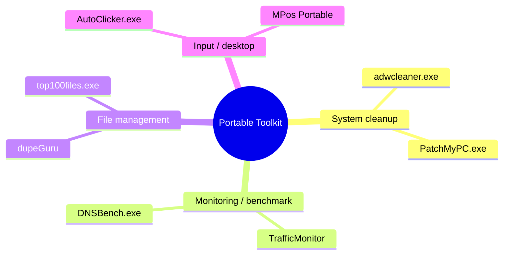

# Portable Toolkit

> A personal grab-bag of portable Windows utilities — no installation, just run the `.exe`.

[](LICENSE)
[](https://github.com/chirag127/portable-toolkit/stargazers)
[](https://github.com/chirag127/portable-toolkit/commits/main)


## What it is / why it exists

Portable Toolkit is a curated bundle of portable Windows utilities kept in one place so a
fresh machine (or a rescue USB stick) is one clone away from useful. Every tool runs directly
from its `.exe` — nothing to install, nothing left behind in the registry. It exists so the
common "I need a duplicate finder / DNS benchmark / adware cleaner *right now*" moment never
requires a download hunt again.

> **Licensing:** This repo bundles pre-compiled **third-party** Windows binaries. Each tool
> retains its own original license; only the repo structure/scripts are MIT.

## Links

- **Repository:** https://github.com/chirag127/portable-toolkit
- **GitHub Pages:** https://chirag127.github.io/portable-toolkit/ — serves the repo landing/about.

## ⭐ Star this repo

If this is useful, please ⭐ star the repo — it helps others find it.

## Tool categories



## Tools

| Tool | Description |
|------|-------------|
| `AutoClicker.exe` | Auto-click utility |
| `DNSBench.exe` | DNS benchmarking tool |
| `PatchMyPC.exe` | Windows software updater |
| `TrafficMonitor/` | Network traffic monitor with taskbar widget |
| `MPos-v.0.4-Portable/` | Mouse position utility |
| `dupeGuru_win64_4.1.1.exe` | Duplicate file finder |
| `adwcleaner.exe` | Adware cleaner |
| `top100files.exe` | Find largest files |
| `ttsetup.exe` | Setup helper |

## Usage

All tools are portable — clone (or download the file you need) and run the `.exe` directly.
No installation required.

```bash
git clone https://github.com/chirag127/portable-toolkit.git
cd portable-toolkit
# double-click any .exe, e.g. dupeGuru_win64_4.1.1.exe
```

## Repo structure

```
portable-toolkit/
├── AutoClicker.exe            auto-click utility
├── DNSBench.exe               DNS benchmarking
├── PatchMyPC.exe              software updater
├── TrafficMonitor/            network traffic monitor + taskbar widget
├── MPos-v.0.4-Portable/       mouse position utility
├── dupeGuru_win64_4.1.1.exe   duplicate file finder
├── adwcleaner.exe             adware cleaner
├── top100files.exe            find largest files
├── ttsetup.exe                setup helper
└── LICENSE                    MIT (repo structure only)
```

## Note

This repository is a **binary bundle** — pre-compiled Windows executables for personal use.
It is intentionally stable/archival rather than actively developed.

## Part of the oriz family

Portable Toolkit is one of ~80 sites and tools in the **oriz** family. Explore the rest at
[blog.oriz.in](https://blog.oriz.in).

## Contributing

This is a personal archival bundle; large binary PRs are generally not accepted. Issues and
suggestions are welcome. Conventional commits are the changelog.

## License

- **Repo structure/scripts:** MIT — see [LICENSE](LICENSE).
- **Bundled binaries:** each third-party tool retains its own original license.

## Author

**Chirag Singhal** — chirag@oriz.in

## Status / roadmap

Stable / archival. Tools are updated occasionally as newer portable builds become available.
